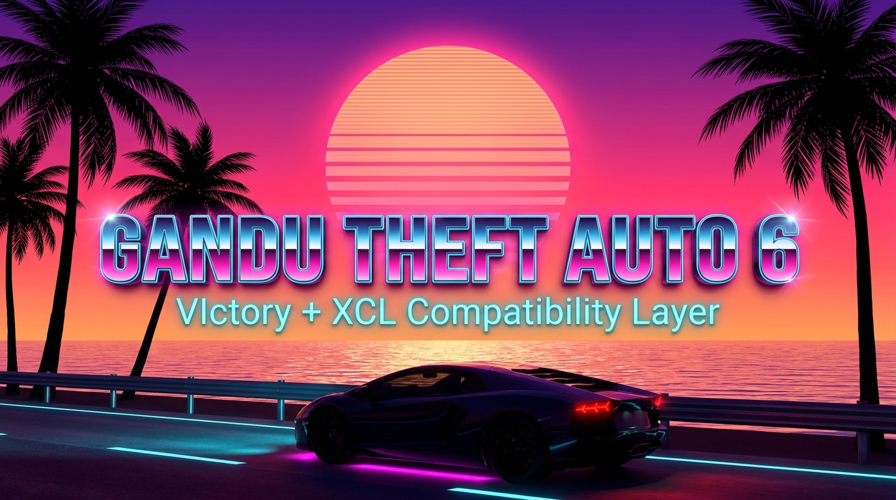

<p align="center">
  
</p>

<h1 align="center">GanduTheftAutoVi</h1>

<p align="center">
  <strong>Unified Xbox Series X|S → Windows Compatibility Layer Workspace</strong><br/>
  Combining <a href="https://github.com/Marvisak/VIctory">VIctory</a> and <a href="https://github.com/xcl-dev/xcl">XCL</a> into a single Rust workspace.
</p>

<p align="center">
  <a href="https://github.com/shadshuvo/GanduTheftAutoVi/actions/workflows/ci.yml">
    
  </a>
  
  
</p>

---

## Overview

**GanduTheftAutoVi** merges two open-source Xbox Series X|S (GDK) → Windows x64 compatibility layer projects into one unified Rust workspace so both runtimes, loaders, HLE modules, shader translators, and test suites live side-by-side:

| Project | Role in Workspace | Upstream | License |
|---------|-------------------|----------|---------|
| **VIctory** | Base workspace, CLI, PE/Loader, HLE, D3D12 GPU, RDNA2→DXIL shader translator | [Marvisak/VIctory](https://github.com/Marvisak/VIctory) | GPL-3.0-or-later |
| **XCL** | Xbox Series X|S compatibility layer (loader, HLE, VFS overlay, RDNA2→DXIL recomp) | [xcl-dev/xcl](https://github.com/xcl-dev/xcl) | GPL-2.0-only |

---

## Workspace Architecture

```text
GanduTheftAutoVi/
├── apps/
│   └── victory/            # VIctory CLI front-end (inspect / census / run / translate)
├── crates/
│   ├── victory-core/       # Core types, config, logging, asset-policy helpers
│   ├── victory-pe/         # PE32+ image parsing & import library inspection
│   ├── victory-loader/     # Console EXE/DLL mapper, TLS, stacks & import binding
│   ├── victory-hle/        # High-level emulation of Xbox system DLLs
│   ├── victory-gpu/        # D3D12.X → host D3D12 translation layer
│   ├── victory-shader/     # RDNA2 (GFX10) → DXIL shader translator
│   ├── victory-formats/    # Texture, BCPack, and XMA audio format decoders
│   ├── victory-pipeline/   # D3D12 pipeline state cache
│   ├── victory-game/       # Game-specific integration & SGD5 handling
│   └── xcl/                # XCL compatibility layer (loader + HLE + VFS + GPU)
├── tests/
│   ├── fixtures/           # VIctory standalone probe fixtures
│   └── xcl/
│       ├── data/           # Synthetic DXIL, LLVM-AMDGPU, BCPack & testgame fixtures
│       ├── testtitle/      # Synthetic console title for XCL integration tests
│       └── testgamedll/    # Fake middleware DLL for XCL integration tests
├── docs/
│   ├── banner.jpg          # Project README banner
│   ├── architecture.md     # VIctory architecture notes
│   └── xcl/                # XCL design specifications
└── xtask/                  # Repository asset-policy & maintenance tasks
```

---

## Prerequisites

- **OS:** Windows 10 / 11 (x64)
- **Toolchain:** Rust `1.98.1` (`x86_64-pc-windows-msvc` — pinned in [`rust-toolchain.toml`](rust-toolchain.toml))
- **Build Tools:** Visual Studio Build Tools with MSVC & Windows SDK
- **Shader Compiler:** DXC (`dxcompiler.dll` / `dxil.dll` from Windows SDK) for shader validation

---

## Building

```powershell
# Build the entire workspace (VIctory + XCL)
cargo build --release

# Build only the VIctory CLI
cargo build --release -p victory

# Build only XCL and its test fixtures
cargo build --release -p xcl -p xcl-testtitle -p testgame-mw
```

## Unified Runtime CLI

`victory` now integrates `xcl` directly as a selectable runtime backend and subcommand:

```powershell
# Run using the default VIctory runtime
victory run <path/to/game.exe> --execute

# Run using the integrated XCL backend
victory run <path/to/game.exe> --backend xcl --execute

# Use XCL's disassembler, shader analyzer, or RPF9 tools via victory
victory xcl inspect <file.exe>
victory xcl disasm <shader_file>
victory xcl shaders <path_or_rpf>
victory xcl rpf <archive.rpf>

# Pre-compile shaders into the shared DXIL cache before launching
victory xcl warmup <game_dir_or_rpf> --limit 0
victory xcl cache-stats
```

---

## Running Tests

```powershell
# Run VIctory clippy + workspace tests (including xtask asset policy)
cargo test --workspace --exclude xcl --exclude xcl-testtitle --exclude testgame-mw

# Run XCL unit & integration tests (hardware-independent subset)
cargo test -p xcl -- --skip test_title_runs_and_game_folder_is_untouched

# Run full XCL end-to-end test on a Windows PC with Gaming Services & GPU
cargo build -p xcl -p xcl-testtitle -p testgame-mw
cargo test -p xcl
```

---


## Notes & Policy

- **No copyrighted assets:** Neither VIctory nor XCL ships any game files, ROMs, or proprietary binaries. Users must supply their own files at runtime.
- See [`victory.example.toml`](victory.example.toml) for VIctory runtime configuration.
- See [`docs/architecture.md`](docs/architecture.md) and [`docs/xcl/`](docs/xcl/) for technical details.
